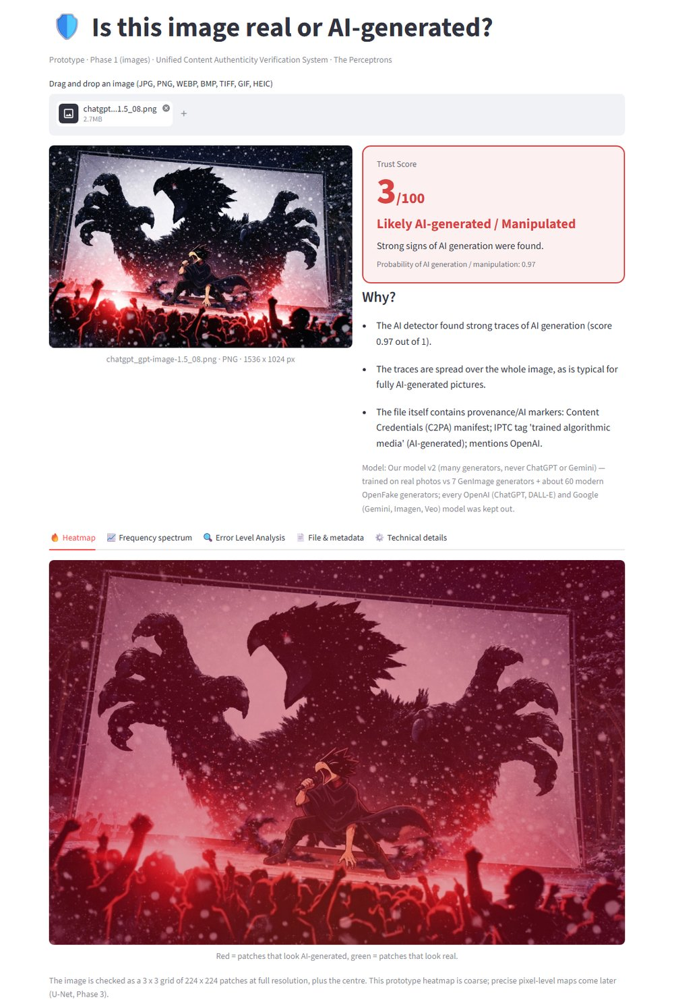
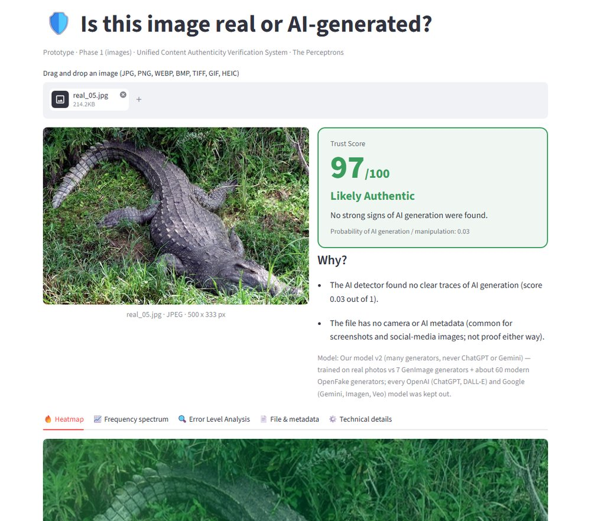
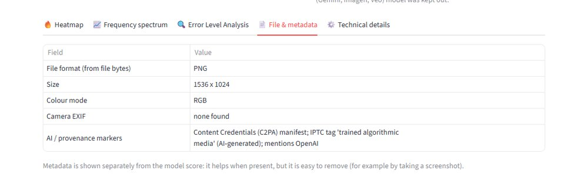
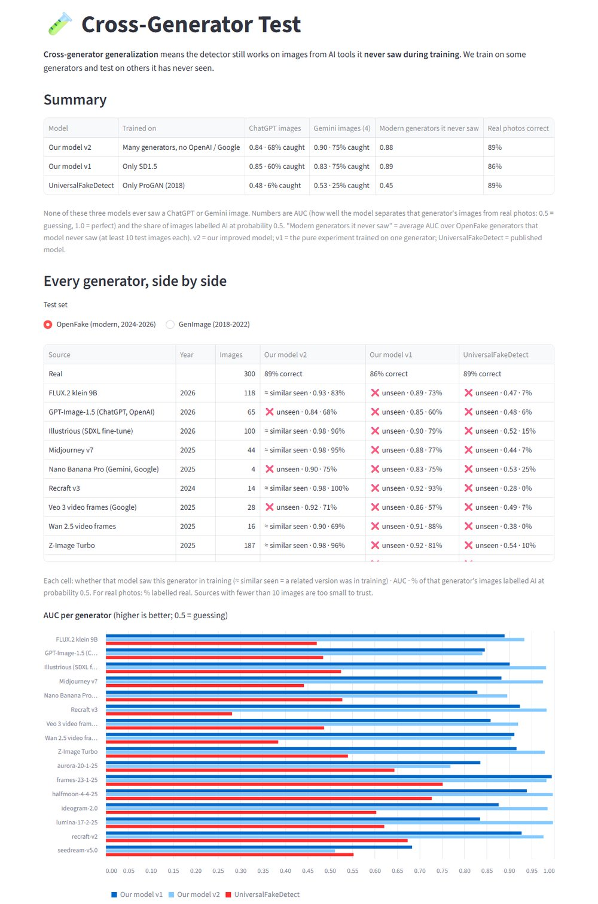
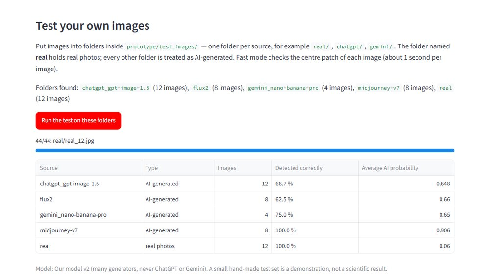

# Walkthrough 01 — Image Prototype (first working demo)

> **Built:** 26–27 Sept 2026 · **Phase:** 1 (Images) · **Status:** working and tested in a browser
>
> **Folder:** `prototype/` · **Run it:** see [Section 2](#2-how-to-run-it) · **Demo tips:** see [Section 11](#11-monday-demo-plan)

---

## 1. What we built (in one paragraph)

A web app where you **drag and drop an image** (any common format) and get back a **Trust Score from 0 to 100**, a **verdict** (Likely Authentic / Needs Human Review / Likely AI-generated), a **heatmap** of the most suspicious areas and a short **explanation**. Behind it is a real AI model: a frozen **CLIP** image encoder plus a small classifier that **we trained ourselves**. A second page, **Cross-Generator Test**, shows how well the model detects AI tools it **never saw during training** — including the image models behind **ChatGPT** and **Gemini**. That page is where our project title becomes visible.

---

## 2. How to run it

First time only (creates a private Python environment with all libraries, about 3 GB):

```
cd "Deepfake Detection"
python -m venv .venv
.venv\Scripts\python -m pip install -r prototype\requirements.txt
```

Every time:

```
.venv\Scripts\streamlit run prototype\app.py
```

The browser opens at `http://localhost:8501`. (The very first time, Streamlit asks for an email address in the terminal — just press Enter to skip.) The first start downloads the CLIP model (about 1.7 GB, once) and loads it (about 30 seconds). After that, **each image takes about 12–15 seconds** on a laptop CPU. No GPU is needed.

---

## 3. The three pages

| Page | What it shows |
|---|---|
| **🔍 Check an image** | Upload (or pick a sample) → Trust Score card, verdict, "Why?" explanation, and tabs: Heatmap · Frequency spectrum · Error Level Analysis · File & metadata · Technical details |
| **🧪 Cross-Generator Test** | (1) Summary: how each model does on ChatGPT, Gemini and other generators it never saw. (2) Every generator side by side, with a bar chart. (3) "Test your own images": runs the model on the folders in `prototype/test_images/` |
| **ℹ️ How it works** | Pipeline diagram and plain-language explanation |

The **sidebar** chooses the model:

| Model | Trained on | Use it for |
|---|---|---|
| **Our model v2** (default) | Real photos vs **many generators** (7 older + about 60 modern), but **no OpenAI and no Google images at all** | The demo: best practical accuracy, and ChatGPT/Gemini images are still **unseen** |
| **Our model v1** | Real photos vs **one generator only** (Stable Diffusion 1.5) | The pure cross-generator experiment |
| **UniversalFakeDetect** | **ProGAN only** (a 2018 GAN), by the authors of a published paper | Comparison with published work |

### What it looks like

**A ChatGPT image** (the model never saw any ChatGPT image during training) → Trust Score 3, *Likely AI-generated*. The heatmap is red everywhere, as expected for a fully AI-generated picture:



**A real photo** → Trust Score 97, *Likely Authentic*:



**File & metadata tab** for the ChatGPT image — the file itself says it was made by OpenAI (C2PA Content Credentials). This is shown separately, because a screenshot would remove it:



---

## 4. What happens when you upload an image (step by step)

| Step | What happens | Why | Code |
|---|---|---|---|
| 1. Read the file | The real format is detected from the file's bytes (not its name). JPG, PNG, WEBP, BMP, TIFF, GIF and iPhone HEIC are opened and converted to plain 8-bit **RGB pixels**. Phone rotation is applied, transparency is put on white, animated images use the first frame. | The model should see only the picture, never the file format. | `forensics.py` → `load_image` |
| 2. Cut patches | The image is cut into **224 × 224 pixel patches at its own resolution**: one in the centre plus a 3 × 3 grid spread over the image (10 patches). | CLIP takes 224 × 224 input. We **crop instead of resize**, because resizing blurs away the tiny traces generators leave. | `detector.py` → `grid_boxes`, `center_crop` |
| 3. Format fix | Each patch is re-saved as JPEG (quality 95). | Datasets often store real photos as JPEG and AI images as PNG, so a model can cheat by learning "PNG = fake". Re-saving everything the same way removes that shortcut. | `detector.py` → `jpeg_normalize` |
| 4. CLIP features | Each patch goes through **CLIP ViT-L/14** (made by OpenAI, trained on about 400 million images). It outputs **768 numbers** that describe the patch. CLIP is **frozen**: we never change it. | A frozen general-purpose model cannot memorise one generator's quirks — the key to detecting new generators (Ojha et al., CVPR 2023). | `detector.py` → `ClipEncoder` |
| 5. Frequency features | For each patch we remove the picture content (subtract a median-filtered copy), take the **FFT** (Fourier transform) of what remains and average it into 64 rings. | AI generators build images by up-sampling, which can leave regular patterns in the frequency spectrum. | `forensics.py` → `frequency_features` |
| 6. Classifier head | A single linear layer (**logistic regression**, 832 inputs) turns the numbers into the **probability that the patch is AI-generated**. | Simple, fast, and too small to over-fit to one generator. | `detector.py` → `Head.logits` |
| 7. Combine | The 10 patch results are averaged (in logit space) into one probability *p*. The 3 × 3 grid of patch probabilities becomes the **heatmap**. | Looking at several places makes the score more stable and shows *where* the traces are. | `detector.py` → `Detector.analyze` |
| 8. Trust Score | **Trust Score = round(100 × (1 − p))**. 65 or more → Likely Authentic; 35 or less → Likely AI-generated; in between → **Needs Human Review**. | One easy number; uncertain cases go to a person instead of a wrong answer. Thresholds are provisional for now. | `trust.py` → `trust_score`, `verdict` |
| 9. Extra evidence | **Frequency spectrum picture**, **Error Level Analysis**, and **metadata**: camera EXIF, editing software, **C2PA Content Credentials** and other AI markers. These need no training. | Extra, explainable signals. Metadata is shown separately because it is easy to remove (for example by taking a screenshot). | `forensics.py` |
| 10. Explanation | 2–4 sentences, each generated from something we actually measured. | Users and examiners see *why*, not just a number. | `trust.py` → `explain` |

---

## 5. Which datasets we used

| Dataset | What it is | How we used it |
|---|---|---|
| **Tiny-GenImage** (Hugging Face: `TheKernel01/Tiny-GenImage`) | A small version of **GenImage** (NeurIPS 2023), the standard benchmark for detecting AI images. Real ImageNet photos + 7 generators from 2018–2022: ADM, BigGAN, GLIDE, Midjourney v5, SD1.5, VQDM, Wukong. | **v1 training:** 800 real + 800 SD1.5. **v2 training:** those, plus 200 images from each of the other 6 generators. **Testing:** 300 real + 125 per generator from the separate validation split (never trained on). |
| **OpenFakeTiny** (Hugging Face: `ComplexDataLab/OpenFakeTiny`) | A small version of **OpenFake** (2025): real photos + about 60 **modern** generators from 2024–2026. | **v2 training:** the *train* split (1,203 images), with **every OpenAI and Google image removed**. **Testing:** the separate *test* split — 300 real + 609 AI images, including **GPT-Image-1.5 (ChatGPT)**, **Nano Banana Pro (Gemini)**, **Veo 3 (Google)**, Midjourney v7, FLUX.2, Z-Image. |

In total we downloaded about 5.5 GB and used about 6,000 images, so everything ran on a laptop CPU overnight.

**Removed from v2's training (so they stay unseen):** OpenAI — `gpt-image-1` (22 images), `dalle-3` (11); Google — `imagen-4.0` (9), `imagen-3.0` (2), `nano-banana` (3). The script checks this automatically and stops if any OpenAI or Google image slips into training.

*Note:* the standard GenImage protocol trains on SD1.4; this copy of the dataset has no SD1.4 images, so v1 trains on **SD1.5**, its direct successor with the same architecture.

---

## 6. How this shows cross-generator generalization

**Cross-generator generalization = the detector still works on images from AI tools it never saw during training.**

It is **not a button** in the app. It is a **test**: train on some generators, then measure accuracy on others. The Cross-Generator Test page shows exactly that:

- **v1** saw only **SD1.5**. Everything else is unseen.
- **v2** saw many generators, but **no OpenAI and no Google** image — so **ChatGPT, Gemini and Veo are unseen** for it.
- **UniversalFakeDetect** saw only **ProGAN**, so every generator in our tests is unseen for it.

### Your friend's question

> "If the model is trained on Gemini images, it learns Gemini's patterns (like smoothness). How can it detect a ChatGPT image it never saw?"

**Short answer:** a well-designed detector does **not** learn "what Gemini images look like". It learns what **all** AI generators have in common, and what **real photos** look like.

1. **Shared traces.** Gemini, ChatGPT, Midjourney and Stable Diffusion are all neural networks that **build pixels by up-sampling** (small → big). That leaves similar fingerprints in fine texture, whichever company made the tool.
2. **Missing camera traces.** A real photo passes through a lens and a camera sensor, which leave natural noise patterns. **No** AI generator has a real lens or sensor. So the model can learn "this lacks camera traces" — true for every generator.
3. **The real side does not change.** Real photos from 2020 and 2030 look the same to the model, so half of what it learns (what "real" looks like) stays valid.
4. **Frozen CLIP stops memorising.** If we trained a big network fully on Gemini images, it *could* memorise "Gemini = smooth" and then fail on ChatGPT. We keep CLIP frozen and train only one small layer.
5. **It is not perfect — and that is what we measure.** If a new generator's traces are very different, accuracy **does** drop (the "generalization gap"). Our results below measure it for every generator. When the model is unsure, the Trust Score lands in **Needs Human Review** instead of a confident wrong answer.

**Our results answer the friend directly:** v2 never saw a single ChatGPT image and still separates ChatGPT images from real photos with **AUC 0.84**. A model trained on one old generator (UniversalFakeDetect, ProGAN) is at **0.48 — no better than guessing**. That gap is exactly what our project is about.

Analogy: a bank cashier trained on fake ₹500 notes from one gang learns the **signs of a fake note** (paper feel, watermark, print sharpness), not that gang's specific notes — so they catch fakes from a new gang too.

---

## 7. Results

**How to read the numbers**

- **AUC** = how well the model separates that generator's images from real photos, at any threshold. 0.5 = guessing, 1.0 = perfect.
- **% caught** = share of that generator's images labelled AI at probability 0.5.
- ❌ = the model **never saw** this generator · ≈ = a **related version** was in training · ✅ = seen in training.
- Sources with fewer than 10 images are too small to trust.

### Summary

| Model | ChatGPT (GPT-Image-1.5, 65 images) | Gemini (Nano Banana Pro, 4 images) | Google Veo 3 (28 frames) | All modern AI images (909) | Real photos correct |
|---|---|---|---|---|---|
| **Our model v2** (no OpenAI/Google in training) | ❌ **0.84** · 68% | ❌ 0.90 · 3 of 4 | ❌ **0.92** · 71% | 0.95 | 89% |
| **Our model v1** (SD1.5 only) | ❌ **0.85** · 60% | ❌ 0.83 · 3 of 4 | ❌ 0.86 · 57% | 0.89 | 86% |
| UniversalFakeDetect (ProGAN only) | ❌ 0.48 · 6% | ❌ 0.53 · 1 of 4 | ❌ 0.49 · 7% | 0.50 | 89% |

The same numbers on the app's **Cross-Generator Test** page:



### Every generator

**Modern generators (OpenFake test set, 2024–2026)** — each cell: seen in training? · AUC · % caught

| Source | Images | Our model v2 | Our model v1 | UniversalFakeDetect |
|---|---|---|---|---|
| Real | 300 | 89% correct | 86% correct | 89% correct |
| Z-Image Turbo | 187 | ≈ 0.98 · 96% | ❌ 0.92 · 81% | ❌ 0.54 · 10% |
| FLUX.2 klein 9B | 118 | ≈ 0.93 · 83% | ❌ 0.89 · 73% | ❌ 0.47 · 7% |
| Illustrious (SDXL fine-tune) | 100 | ≈ 0.98 · 96% | ❌ 0.90 · 79% | ❌ 0.52 · 15% |
| **GPT-Image-1.5 (ChatGPT, OpenAI)** | 65 | ❌ 0.84 · 68% | ❌ 0.85 · 60% | ❌ 0.48 · 6% |
| Midjourney v7 | 44 | ≈ 0.98 · 95% | ❌ 0.88 · 77% | ❌ 0.44 · 7% |
| **Veo 3 video frames (Google)** | 28 | ❌ 0.92 · 71% | ❌ 0.86 · 57% | ❌ 0.49 · 7% |
| Wan 2.5 video frames | 16 | ≈ 0.90 · 69% | ❌ 0.91 · 88% | ❌ 0.38 · 0% |
| Recraft v3 | 14 | ≈ 0.98 · 100% | ❌ 0.92 · 93% | ❌ 0.28 · 0% |
| **Nano Banana Pro (Gemini, Google)** | 4 | ❌ 0.90 · 75% | ❌ 0.83 · 75% | ❌ 0.53 · 25% |
| 8 other small generators | 3–6 each | see the app | | |

**Older generators (GenImage test set, 2018–2022)**

| Source | Images | Our model v2 | Our model v1 | UniversalFakeDetect |
|---|---|---|---|---|
| Real | 300 | 87% correct | 96% correct | 96% correct |
| ADM | 125 | ✅ 0.96 · 94% | ❌ 0.87 · 26% | ❌ 0.80 · 12% |
| BigGAN | 125 | ✅ 0.98 · 98% | ❌ 0.57 · 4% | ❌ 0.97 · 79% |
| GLIDE | 125 | ✅ 0.99 · 98% | ❌ 0.92 · 52% | ❌ 0.83 · 14% |
| Midjourney v5 | 125 | ✅ 0.97 · 94% | ❌ 0.96 · 74% | ❌ 0.77 · 14% |
| SD1.5 | 125 | ✅ 0.99 · 100% | ✅ 1.00 · 99% | ❌ 0.88 · 25% |
| VQDM | 125 | ✅ 0.97 · 94% | ❌ 0.90 · 42% | ❌ 0.95 · 65% |
| Wukong | 125 | ✅ 0.98 · 96% | ❌ 0.99 · 94% | ❌ 0.90 · 37% |

**Extra check — large real camera photos.** We also ran v2 on 5 high-resolution photos from Wikimedia Commons (Canon, Sony and Nikon cameras, 3,800–6,000 pixels wide), to make sure a teacher's own phone or camera photo is not wrongly flagged: 4 came out **Likely Authentic** (Trust Scores 97, 95, 87, 66) and 1 **Needs Human Review** (51). None was wrongly called AI-generated.

**Demo folder test** (the "Test your own images" button, 44 demo images, fast centre-patch mode, model v2):



### What the results mean (the honest version)

1. **Cross-generator generalization works — and it matters which features you use.** A detector trained on one old GAN (UniversalFakeDetect) collapses to guessing on modern generators (AUC ≈ 0.50). Our model v1, trained on **one** generator (SD1.5) with only 1,600 images, still reaches AUC 0.85–0.92 on ChatGPT, Veo and other modern generators it never saw.
2. **Training on more generators helps, even without seeing the target.** v2 never saw an OpenAI or Google image, yet catches more ChatGPT (68% vs 60%) and Veo images (71% vs 57%) than v1 at the same threshold.
3. **ChatGPT is the hardest case.** Separation is good (AUC 0.84), but at the default threshold only about two-thirds are caught.
4. **JPEG compression is the biggest weakness.** On our 12 ChatGPT demo images, v2 caught **6 of 6 original PNG downloads** but only **1 of 6 JPEG copies** — compression wipes out the fine traces. This matches the "robustness" gap in our research, and Phase 1 fixes it by training on compressed copies (roadmap Week 8).
5. **A GAN is different from a diffusion model.** v1 (trained only on the diffusion model SD1.5) struggles with BigGAN (AUC 0.57), while the ProGAN-trained model does well on it (0.97). Another reason to train on several generator families, as v2 does.
6. **Trade-off on real photos.** v2 labels 87–89% of real photos correctly (v1: 86–96%). A few real photos land in "Needs Human Review" — by design, better than a wrong verdict.
7. **What did *not* help (yet):**
    - the **frequency features** made no measurable difference (AUC 0.89 with, 0.90 without);
    - the **spectral-peak number** did not separate real from AI images (median 2.21 vs 2.19), so we removed it from the explanation;
    - the **format fix** did not raise the modern-generator AUC. The model *without* it scored suspiciously high on GenImage (0.97), most likely by exploiting "real = JPEG, fake = PNG", so we keep the fix.

---

## 8. Technology used

| Tool | What we use it for |
|---|---|
| **Python 3.11** | Programming language |
| **PyTorch** (CPU) | Runs the CLIP neural network |
| **open_clip** | Loads OpenAI's pretrained CLIP ViT-L/14 weights |
| **scikit-learn** | Trains our logistic-regression heads (with 5-fold cross-validation); computes AUC and accuracy |
| **NumPy** | Arrays and the FFT (frequency spectrum) |
| **Pillow + pillow-heif** | Opens every image format, including iPhone HEIC; JPEG re-saving; ELA |
| **Matplotlib** | Colour map for the heatmap |
| **Streamlit** | The web app (upload, pages, tables, charts) |
| **pandas / pyarrow** | Tables; reading the dataset files (Parquet format) |
| **Hugging Face Hub** | Downloading the datasets and the CLIP weights |
| **Playwright** (testing only) | Opened the app in a real browser, uploaded images and took screenshots to check every page |

---

## 9. Files created

```
prototype/
  app.py              the Streamlit web app (3 pages)
  detector.py         CLIP encoder, patches, the three classifier heads
  forensics.py        file loading, FFT spectrum, ELA, metadata
  trust.py            Trust Score, verdict, heatmap picture, explanations
  experiment.py       the experiment: train v1 and v2, test every generator
  requirements.txt    list of libraries
  weights/            ufd_fc_weights.pth (published), our_head* (v1),
                      our_head_v2* (v2), thresholds.json
  results/            crossgen_results.json (Cross-Generator page numbers)
  test_images/        44 demo images by source + README
data/                 datasets, features, logs (not on GitHub)
.venv/                private Python environment (not on GitHub)
```

To repeat the experiment: `python prototype/experiment.py extract`, then `train`, then `extract_v2`, then `train_v2` (about 3 hours on a laptop CPU in total).

---

## 10. What to say to the supervisor (2 minutes)

1. "This is our Phase 1 prototype. You upload any image and get a Trust Score, a verdict, a heatmap and an explanation."
2. "Inside, the image is cut into patches, each patch goes through a frozen CLIP model, and a small classifier **we trained** gives the probability that it is AI-generated."
3. "To test cross-generator generalization, we **removed every OpenAI and Google image from training**, then tested on images from **ChatGPT's and Gemini's** image models. Our model still separates them from real photos with AUC 0.84–0.90, while a published detector trained on one older generator is at 0.5 — guessing."
4. "We also trained a version on **only one generator**, Stable Diffusion 1.5, and it still reaches 0.85 on ChatGPT images. This page shows every generator side by side."
5. "Our main weakness is JPEG compression: compressed copies hide the traces. That is the next step in Phase 1, together with calibration and more training data."

---

## 11. Monday demo plan

1. Start the app **before** the meeting (`.venv\Scripts\streamlit run prototype\app.py`) and analyse one image, so the model is already loaded.
2. **Check an image** → pick samples from the drop-down under the upload box:
    - `chatgpt_gpt-image-1.5 / ..._08.png` or `..._12.png` → **Likely AI-generated** (Trust Score 3). Show the Heatmap and the File & metadata tab (C2PA "made by OpenAI" marker).
    - `real / real_05.jpg` (or any real photo) → **Likely Authentic**.
    - `gemini_nano-banana-pro / ..._01.jpg` → **Likely AI-generated** (Trust Score 12), with no metadata to help — the model alone.
3. Open **Cross-Generator Test** → explain the Summary table (ChatGPT/Gemini unseen; v2 vs published model).
4. If the teacher uploads **her own photo**: large camera photos came out Authentic or Needs Review in our check. If it lands in Needs Review, say: "that's the review band working — the model is unsure, so it asks a human instead of guessing."
5. If a ChatGPT **JPEG** gets a high Trust Score: "compression wipes out the traces — that's the robustness problem our Phase 1 fixes."

---

## 12. Honest limitations

- **Small experiment.** 6,000 images in total; only 4 Nano Banana Pro (Gemini) test images. It demonstrates the idea; Phase 1 uses much more data.
- **Provisional thresholds.** The 35 / 65 verdict bands are not yet chosen on validation data, and the probabilities are not yet calibrated.
- **JPEG weakness.** Compressed images are much harder (Section 7, point 4).
- **Coarse heatmap.** 3 × 3 patches, not an exact outline of edited pixels (that comes with the U-Net in Phase 3).
- **Metadata is not proof.** It can be removed or faked; it is shown separately from the model.
- **Speed.** About 12–15 seconds per image on a laptop CPU.

---

## 13. Build log (what we actually did)

1. Read the published detector's code (UniversalFakeDetect): CLIP ViT-L/14 + one linear layer, centre crop 224, trained on ProGAN; downloaded its 4 KB head weights (MIT licence).
2. Created a Python virtual environment (`.venv`) and installed the libraries in `prototype/requirements.txt` (one retry after a network drop).
3. Found two small datasets on Hugging Face and downloaded only slices of them.
4. Found that this GenImage copy has **no SD1.4** images → v1 trains on **SD1.5**.
5. Found that OpenFake contains **GPT-Image-1.5 (ChatGPT)** and **Nano Banana Pro (Gemini)** — ideal unseen-generator tests.
6. Wrote the code: `forensics.py`, `detector.py`, `trust.py`, `experiment.py`, `app.py`.
7. Measured speed: about 1 second per 224 × 224 patch on the laptop CPU.
8. Rewrote the data loading to stream files in small batches, because the laptop has 7.8 GB RAM.
9. Extracted CLIP and frequency features for 3,684 images (about 2 hours), trained **v1** and evaluated it on every generator.
10. Tested the app in a real browser: it worked, but v1 misjudged two demo images (it was trained on centre patches only, while the app averages 10 patches).
11. Built **v2**: added the other GenImage generators and the OpenFake *train* split, with a random patch per image as well as the centre.
12. Caught a problem before training v2: the OpenFake train split contained `gpt-image-1` (OpenAI) and `nano-banana` (Google). **Removed every OpenAI and Google image** and added an automatic check, so ChatGPT and Gemini stay truly unseen.
13. Corrected the "seen/unseen" labels: many modern generators have related versions in v2's training (for example Midjourney v6 → v7), so for v2 only the OpenAI/Google generators are counted as unseen.
14. Checked v2 on large real camera photos (no false "AI" verdicts), removed the uninformative spectral-peak sentence, redesigned the Cross-Generator page, and re-tested every page with screenshots.
